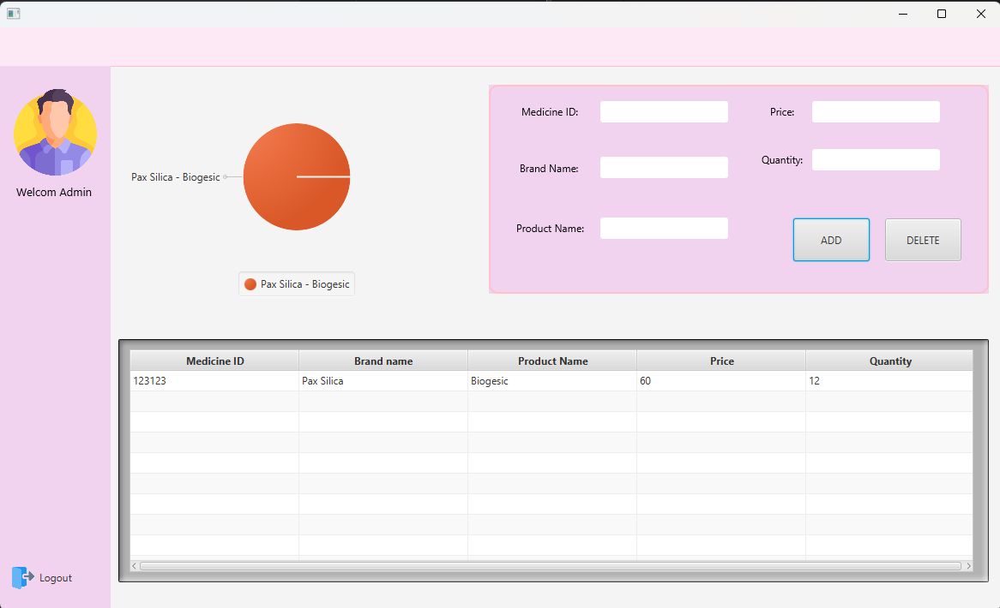

# Pharmacy Inventory System (JavaFX)

My first Java project: a desktop app for managing a pharmacy's medicine
inventory. Built as the final project for Object-Oriented Programming
(2nd year, 1st semester). Written entirely on my own, with no AI help.



## Features
- Login screen with an animated image
- Add, edit and delete medicines in a table
- Live pie chart of stock per product

## OOP and Java concepts used
- **Encapsulation:** `Medicine` keeps its fields private and exposes
  getters and setters
- **MVC-style separation:** FXML views, controller classes, and a model class
- **Interfaces:** controllers implement `Initializable`
- **Collections and generics:** `ObservableList`, `Map`, `TableView<Medicine>`
- **Event handling:** button actions and editable table cells
- **JavaFX:** TableView, PieChart, animations, FXML layouts

## Tech stack
Java 20 · JavaFX 20.0.1 · Maven · IntelliJ IDEA

## Run it
```bash
./mvnw javafx:run
```
Demo login: `admin` / `password`

## What I'd improve today
- Save data to a database or file (it resets when the app closes)
- Validate input (empty fields, non-numeric quantity)
- Replace the hardcoded login with hashed passwords
- Use `double`/`int` types for price and quantity instead of `String`
- Add unit tests

## Flowchart

